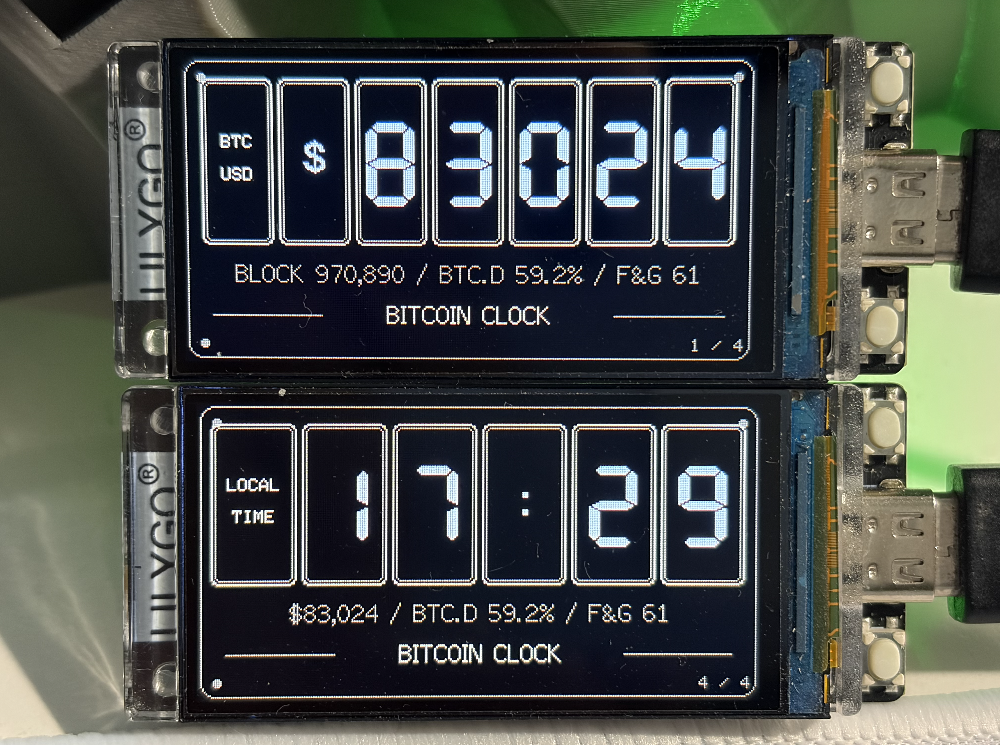
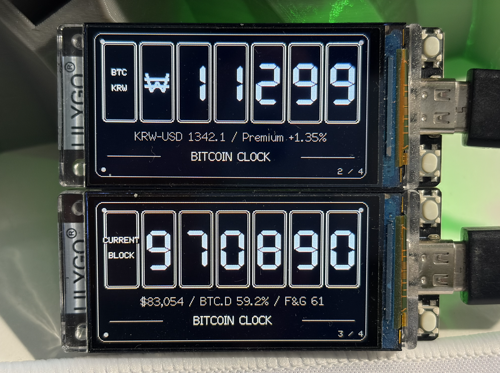

# Bitcoin Clock

**Bitcoin Clock V1** is a small ESP32-based Bitcoin information display device. It does not execute mining or Stratum functions, but displays the latest block height, BTC/USD and BTC/KRW prices, and Korean time.

## Original and License

This project is a derivative work based on [BitMaker-hub/NerdMiner_v2](https://github.com/BitMaker-hub/NerdMiner_v2), modified for Bitcoin Clock purposes. The original MIT license and copyright notice are preserved in [LICENSE](LICENSE).

The repository also includes libraries and fonts distributed under separate terms. Check [THIRD_PARTY_NOTICES.md](THIRD_PARTY_NOTICES.md) for those items and notice locations. The root MIT license does not replace the licenses of third-party assets with separate notices.

## Supported Boards

The currently supported board is **LILYGO T-Display-S3**. The PlatformIO environment name is `Lilygo-T-Display-S3`.

## Screen Examples





## Screens and Buttons

- On the T-Display-S3, press button 1 to cycle through the BTC/USD price, BTC/KRW price, block height, and Korean time screens. The BTC/USD price screen is displayed by default upon booting.
- Block height is fetched from mempool.space, BTC/USD from the Binance public API, and BTC/KRW from the Upbit public API. An API key is not required for public current price inquiries on either exchange.
- The BTC/KRW price is displayed rounded to the nearest 10,000 KRW along with the won symbol (`₩`). For example, `₩ 11575` on the screen means approximately 115,750,000 KRW (11,575 ten-thousand KRW).
- The block and price screens use 7 fixed tiles. If values become longer, secondary labels are hidden in the order of `CURRENT BLOCK`, `BTC USD`/`BTC KRW`, and the currency symbol to secure digit spaces.
- The name `BITCOIN CLOCK` is displayed at the bottom of the screen. The secondary line of the BTC/USD screen sequentially displays the current block height, CoinGecko's Bitcoin dominance, and Alternative.me's Crypto Fear & Greed Index. The secondary lines of the block height and clock screens display the Binance BTC/USD price, Bitcoin dominance, and F&G index. The BTC/KRW screen displays Frankfurter's USD/KRW reference exchange rate and the kimchi premium in the format `KRW-USD 1342.1 / Premium +1.52%`. The kimchi premium is calculated as `(Upbit BTC/KRW ÷ (Binance BTC/USDT × Frankfurter USD/KRW exchange rate) - 1) × 100`, and a minus sign is also displayed if it is negative. Prices are fetched at 5-second intervals, block heights at 2-minute intervals, and exchange rates, dominance, and F&G at 5-minute intervals. If temporary issues occur with the network or API, the last successfully received values are maintained and a retry is attempted after 30 seconds. Upon Wi-Fi reconnection, cached prices and indicators are refreshed immediately.
- The T-Display-S3 time and automatic brightness schedule follow the local time of the configured time zone. Regions where daylight saving time applies, such as the US, are automatically adjusted according to the season.
- Prices and block heights are automatically updated when the network is connected.
- Briefly pressing button 2 changes the screen brightness in the order of Off → 25% → 50% → 75% → 100%. Long-pressing it resets the settings.
- The T-Display-S3 automatic brightness schedule can be turned on or off in the settings, with the default being off. When off, the boot brightness is 75% and can be adjusted with buttons without automatic changes. When on, upon NTP synchronization, the current brightness of the local time zone is applied, and then it changes to Off for 00:00–05:30 on weekdays, 25% for 05:30–07:00, 50% for 07:00–09:00, 75% for 09:00–11:00, Off for 11:00–17:00, and 50% for 17:00–24:00. For weekends, it is Off for 00:00–05:30, 25% for 05:30–07:00, 50% for 07:00–09:00, 75% for 09:00–18:00, and 50% for 18:00–24:00. Pressing a button during off hours turns it on to 50%, and that brightness is maintained until the next schedule boundary.

## Wi-Fi Setup

When setting up for the first time, connect to the device's `BitcoinClock` access point.

- Network name: `BitcoinClock`
- Default password: `BitcoinClock`
- On the setup page, you can select the Wi-Fi network and local time zone from drop-down menus, and turn the automatic brightness schedule on or off. The default is `Asia/Seoul`. Supported regions are `Asia/Seoul`, `Asia/Tokyo`, `Asia/Shanghai`, `Asia/Singapore`, `UTC`, `America/New_York`, `America/Chicago`, `America/Denver`, `America/Phoenix`, `America/Los_Angeles`, `America/Anchorage`, `Pacific/Honolulu`, `Europe/London`, `Europe/Paris`, `Australia/Sydney`, and `Pacific/Auckland`.
- If saved Wi-Fi connections fail after 3 trials, a guide is displayed on the screen and the `BitcoinClock` configuration access point is opened. Wi-Fi names and passwords are saved inside the device by WiFiManager, not in `config.json`. `config.json` is for app settings such as full configurations and time zones.
- The S3 time zone is selected from a list, and only regions supported by the firmware are displayed. If you re-enter the configuration portal to change the time zone, you may need to re-enter your Wi-Fi connection information as well.

## Build

Build with the following command in an environment where PlatformIO Core is installed:

```sh
# T-Display-S3
pio run -e Lilygo-T-Display-S3
```

The firmware version on the screen is `V1`. Build files are generated under `.pio/build/<environment>/` of the selected environment.

## Flashing Firmware Without PlatformIO

Even without installing PlatformIO, you can download a matching `*_factory.bin` file for your board from [GitHub Releases](https://github.com/unsoft/bitcoin-clock/releases/latest) and write it directly to the ESP32. `*_factory.bin` is an integrated image containing the bootloader, partition table, and app firmware. `*_firmware.bin` is for app updates, so do not use it for initial USB flashing.

1. Download the `Lilygo-T-Display-S3_factory.bin` file from GitHub Releases.
2. Connect the board with a USB cable and install [Espressif esptool](https://github.com/espressif/esptool). Python must be installed.

   ```sh
   python3 -m pip install esptool
   ```

3. Check the serial port of the board on your operating system. Names look like `/dev/cu.usbmodem...` or `/dev/cu.usbserial...` on macOS, `/dev/ttyACM0` or `/dev/ttyUSB0` on Linux, and `COM3` on Windows.
4. Move to the folder containing the downloaded file in the terminal, and run the command matching your board. Replace `PORT` below with your actual port name.

   ```sh
   # LILYGO T-Display-S3 (ESP32-S3)
   python3 -m esptool --chip esp32s3 --port PORT --baud 460800 write_flash 0x0 Lilygo-T-Display-S3_factory.bin
   ```

   If the `python3` command cannot be found on Windows, use `py -m esptool`. If the upload fails, lower the baud rate to `--baud 115200` and try again, holding down the board's `BOOT` button while connecting the USB and executing the command if necessary.

5. Restart the board when finished. A separate command to erase the entire flash also deletes settings and saved Wi-Fi information, so do not run it unless you are performing a special reset.
